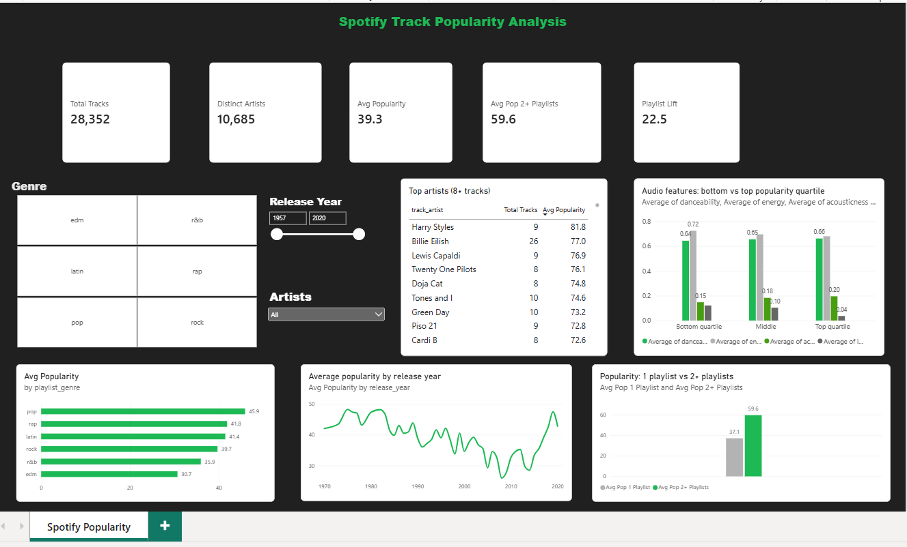

# Spotify Track Popularity Analysis

An end-to-end analysis of what is associated with a track's popularity on Spotify: data cleaning in Python, querying in SQL Server, exploratory analysis in a notebook, and an interactive Power BI dashboard.



## Key findings

| Finding | Result |
|---|---|
| **Playlist reach is the strongest signal** | Tracks on 2+ playlists average **59.6** popularity vs **37.1** for single-playlist tracks. The gap holds within a genre (pop: 64.7 vs 41.0). |
| **Audio features explain little** | Spearman rank correlations are weak; the strongest is instrumentalness at **-0.17**, then acousticness at +0.12. |
| **Genre matters** | Pop is highest (45.9 average), then rap (41.8), latin (41.4), rock (39.7), r&b (35.9) and EDM lowest (30.7). |
| **Top vs bottom quartile** | Top-quartile tracks sit on about **1.40** playlists vs **1.05**, and are far less instrumental (0.036 vs 0.121). |
| **Release year is U-shaped** | Older tracks still on these playlists (1970s-80s) and recent releases (2017-2019) score highest; the low point is around 2008. |

These are associations in one playlist-based dataset, not causal effects. Playlist reach in particular may work in both directions: popular tracks get added to more playlists, and more playlists may lift popularity.

## Pipeline

```
spotify_songs.xlsx  ->  Python cleaning  ->  spotify_clean.csv  ->  SQL Server  ->  Power BI
                                                  |
                                           EDA notebook
```

### 1. Data cleaning (Python, Pandas, NumPy)
Source: 32,833 rows x 23 columns.
- Dropped **5** rows with missing track names.
- Corrected **329** text values that Excel had auto-converted to numbers, dates or times (98 track names, 19 artists, 212 album names).
- Reconciled **1,855** year-only release dates (set to Jan 1 and flagged in `release_date_is_approx`; 1,656 remain flagged after deduplication).
- Computed `playlist_count` (playlists per track) before deduplicating.
- Deduplicated to **28,352** unique tracks.

### 2. SQL Server
Loaded the clean file into `SpotifyDB.dbo.spotify_tracks` and wrote queries using CTEs and window functions (`RANK`, `NTILE`, `LAG`, `PERCENTILE_CONT`):
- Popularity across the 6 genres
- Popularity by release year, with year-over-year change
- Ranking of the **655** artists with 8+ tracks
- Top vs bottom popularity quartile contrast

### 3. Exploratory analysis (Python)
`python/02_eda.ipynb` covers the popularity distribution, genre comparison, playlist-reach effect, Spearman correlations, release-year trend and quartile comparison. Charts are saved to `docs/figures/`.

### 4. Power BI dashboard
Connects to SQL Server and offers genre, release-year and artist filters, KPI cards, a genre comparison, a release-year trend, a playlist-reach comparison, a top-artists table and an audio-feature comparison by popularity tier, so a non-technical audience can explore the findings.

## Repository structure

```
spotify-track-popularity-analysis/
├── README.md
├── requirements.txt
├── data/
│   ├── raw/spotify_songs.xlsx
│   └── processed/spotify_clean.csv
├── python/
│   ├── 01_clean_spotify.py
│   └── 02_eda.ipynb
├── sql/
│   ├── 01_create_table.sql
│   ├── 02_genre_popularity.sql
│   ├── 03_year_popularity.sql
│   ├── 04_top_artists.sql
│   └── 05_popularity_quartiles.sql
├── powerbi/
│   ├── spotify_dashboard.pbix
│   └── dashboard_preview.png
└── docs/figures/
```

## How to reproduce

1. **Set up Python**
   ```bash
   python -m venv venv
   venv\Scripts\activate          # Windows
   pip install -r requirements.txt
   ```
2. **Clean the data** (run from the `python/` folder)
   ```bash
   python 01_clean_spotify.py
   ```
   This reads `data/raw/spotify_songs.xlsx` and writes `data/processed/spotify_clean.csv`.
3. **Load into SQL Server** (2017 or later). Open `sql/01_create_table.sql` in SSMS, change the file path in the `BULK INSERT` line to match where the repo lives, and run it. Expected checks: 28,352 tracks, 6 genres, 655 artists with 8+ tracks, 59.6 vs 37.1.
4. **Run the analysis queries** `sql/02` to `sql/05` in SSMS.
5. **Run the notebook** `python/02_eda.ipynb` with the project's virtual environment.
6. **Open the dashboard.** In Power BI Desktop, open `powerbi/spotify_dashboard.pbix`. If it prompts for a data source, point it to server `localhost`, database `SpotifyDB`.

## Technical notes and limitations

- **Genre is assigned once per track.** A track on several playlists keeps the genre from the first playlist row retained during deduplication, so genre results for those tracks are somewhat arbitrary.
- **Artist names are compared case-insensitively** in SQL Server and Power BI, so 10,685 distinct artists are counted (10,692 if case is treated as significant, e.g. "Audrey" vs "audrey").
- **Year-only release dates** are stored as Jan 1 and excluded from the release-year analysis, and years with fewer than 50 tracks are skipped.
- **Quartiles contain ties.** Many tracks share the same popularity score (including a spike at 0), so quartile boundaries overlap slightly; ties are broken by `track_id` so results are repeatable.
- **Excel-converted titles are restored on a best-effort basis.** Plain numbers (such as a track titled "1985") are recovered exactly; values Excel turned into dates or times are reconstructed from their displayed form.
- **The data is a snapshot, not a sample of all of Spotify.** 2019 alone holds about a quarter of the tracks, and the most recent year is incomplete, so recent-year averages should be read with care.

## Tools

Python (Pandas, NumPy, SciPy, Matplotlib, Seaborn), Microsoft SQL Server, Power BI, Git.

## Data source

Spotify songs dataset from the [TidyTuesday](https://github.com/rfordatascience/tidytuesday/tree/master/data/2020/2020-01-21) project (week of 2020-01-21): 32,833 rows and 23 columns of track, playlist and audio-feature data collected through the Spotify API. This project used an Excel (`.xlsx`) copy of the data, which is why some text values had been auto-converted and needed repair during cleaning. The data is used here for educational and portfolio purposes; see the TidyTuesday repository for its terms.